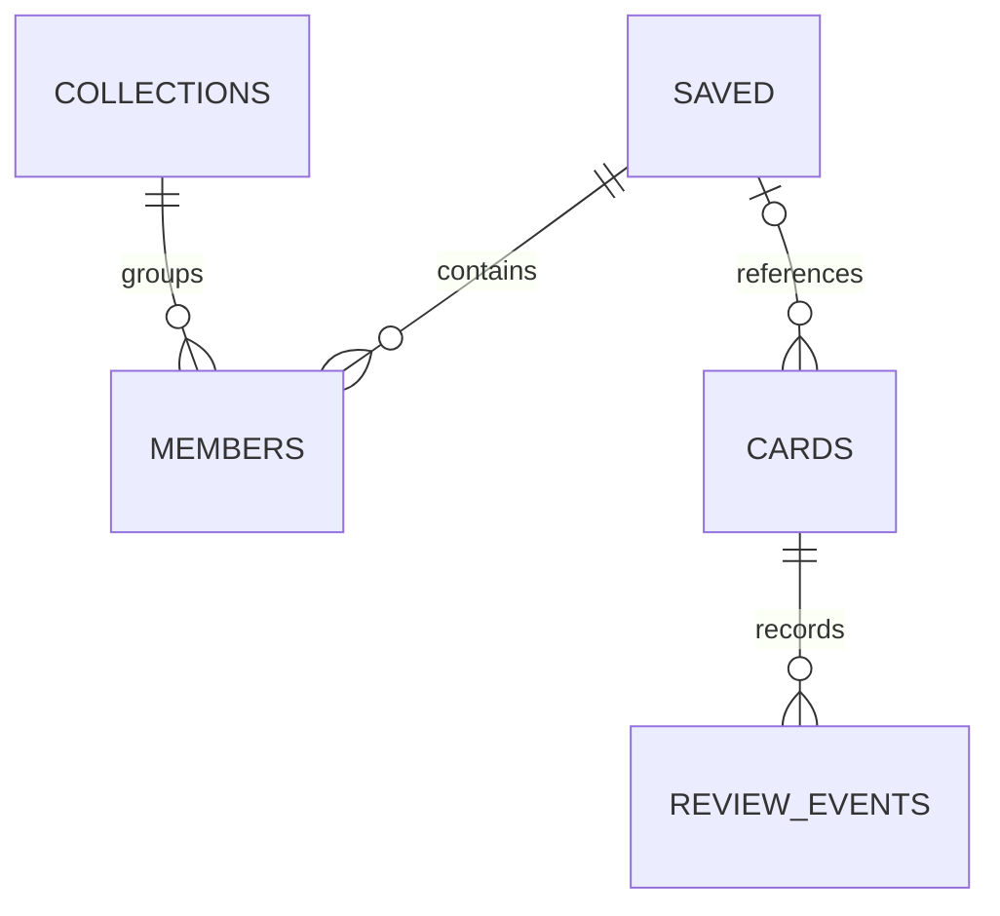

# Архитектура Android-клиента LexiFlow

Приложение написано на Java и использует XML, Material Components и SDK 29+. Основные разделы — словарь, личный словарь и повторение. Из них открываются статья, подборки и прогресс. Настройки доступны из верхней панели.

| Компонент | Роль |
| --- | --- |
| `MainActivity`, `Screen` | Отображение экранов, действий и пустых состояний. Ограниченный список поиска встроен в текущую прокрутку. |
| `FoundationViewModel` | Маршруты и черновик в SavedStateHandle, задержка поиска 250 мс, защита от устаревших результатов, публикация состояния из фоновых задач. |
| `DictionaryRepository`, `LocalDictionaryRepository` | Проверка и открытие SQLite-пакета в режиме чтения, поиск, загрузка статьи, значений, примеров и атрибуции. |
| `SearchNormalization` | NFC, полная регистровая свёртка Android ICU, повторная NFC и нормализация пробелов. |
| `PersonalDatabase` | Отдельная база Room с сохранёнными объектами, подборками, карточками и историей. |
| `ReviewScheduler` | Экспериментальное расписание с явным входным временем. |

Настройки получают статус из состояния словарного репозитория. Отрисовка личных данных ограничена экранами личного словаря, подборок, повторения и прогресса. Поиск сохраняет позицию при переходе к статье. В результатах видно часть речи, предварительный перевод и совпавшую форму. Список остаётся в существующей прокрутке и ограничен 50 строками.

## Личное хранилище

Сохранённый объект имеет постоянный ID статьи, необязательный ID значения, снимок написания и перевода, свой перевод и заметку. Уникальная пара ID предотвращает повторное сохранение. Членство в подборках хранится отдельно. Удаление членства оставляет запись в личном словаре. Удаление самой записи требует подтверждения, после него карточки перестают появляться в очереди, а история сохраняется. Если статья исчезнет из пакета, личное хранилище сохранит снимок.

Карточки задаются сохранённым объектом и направлением. В пользовательском ответе свой перевод имеет приоритет. «Не знаю» возвращает карточку через 10 минут, «Трудно» через день, «Знаю» удваивает интервал с минимумом два дня и максимумом 365. Запись события и обновление срока выполняются в одной транзакции. Проверка прежнего срока защищает от повторного принятия одного ответа. Для статистики «Трудно» и «Знаю» считаются успешными, «Не знаю» — неуспешным. Сроки и показатели считаются по фактическим данным при открытии раздела или локальном изменении.

Экспорт схемы Room v1 зафиксирован в `app/schemas/app.lexiflow.data.PersonalDatabase/1.json`. Текущий переход сохраняет версию и структуру таблиц личной базы. При будущей смене версии потребуются явная миграция и проверка старых данных.

[Словарная интеграция](ANDROID_DICTIONARY_INTEGRATION.md) · [Проверки](TEST_PLAN.md)
