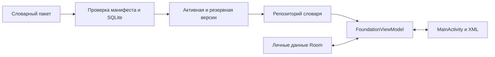
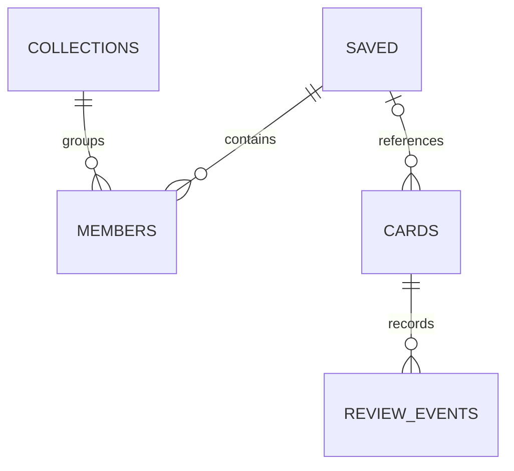

# Архитектура Android-клиента LexiFlow

Приложение написано на Java и использует XML, Material Components и SDK 29+. Основные разделы — словарь, личный словарь и повторение. Из них открываются статья, подборки и прогресс. Настройки доступны из верхней панели.

| Компонент | Роль |
| --- | --- |
| `MainActivity`, `Screen` | Отображение экранов, действий и пустых состояний. Ограниченный список поиска встроен в текущую прокрутку. |
| `FoundationViewModel` | Маршруты и черновик в SavedStateHandle, задержка поиска 250 мс, защита от устаревших результатов, публикация состояния из фоновых задач. |
| `DictionaryRepository`, `LocalDictionaryRepository`, `PackageManifest` | Проверка и чтение SQLite V1/V2 с плоским или компактным манифестом, поиск, загрузка статьи и атрибуции. Компактные ссылки используют общие неизменяемые политики. |
| `DictionaryPackageStore` | Атомарный указатель на активную и резервную версии, чтение старого формата указателя, ограничение числа проверенных каталогов. |
| `DictionarySearch` | Индексированные ветви для словарных написаний, форм и русских эквивалентов. Точные совпадения ранжируются перед префиксами. |
| `SearchNormalization` | NFC, полная регистровая свёртка Android ICU, повторная NFC и нормализация пробелов. |
| `PersonalDatabase` | Отдельная база Room с сохранёнными объектами, подборками, карточками и историей. |
| `ReviewScheduler` | Экспериментальное расписание с явным входным временем. |

Настройки получают статус из состояния словарного репозитория. Отрисовка личных данных ограничена экранами личного словаря, подборок, повторения и прогресса. Поиск сохраняет позицию при переходе к статье. В результатах видно часть речи, предварительный перевод и совпавшую форму. Список остаётся в существующей прокрутке и ограничен 50 строками.

## Личное хранилище

Сохранённый объект имеет постоянный ID статьи, необязательный ID значения, снимок написания и перевода, свой перевод и заметку. Уникальная пара ID предотвращает повторное сохранение. Членство в подборках хранится отдельно. Удаление членства оставляет запись в личном словаре. Удаление самой записи требует подтверждения, после него карточки перестают появляться в очереди, а история сохраняется. Если статья исчезнет из пакета, личное хранилище сохранит снимок.

Карточки задаются сохранённым объектом и направлением. В пользовательском ответе свой перевод имеет приоритет. «Не знаю» возвращает карточку через 10 минут, «Трудно» через день, «Знаю» удваивает интервал с минимумом два дня и максимумом 365. Запись события и обновление срока выполняются в одной транзакции. Проверка прежнего срока защищает от повторного принятия одного ответа. Для статистики «Трудно» и «Знаю» считаются успешными, «Не знаю» — неуспешным. Сроки и показатели считаются по фактическим данным при открытии раздела или локальном изменении.

Экспорт схемы Room v1 зафиксирован в `app/schemas/app.lexiflow.data.PersonalDatabase/1.json`. Текущий переход сохраняет версию и структуру таблиц личной базы. При будущей смене версии потребуются явная миграция и проверка старых данных.

Личный словарь и открытая подборка загружают до 50 записей на страницу. Снимок представления относится к текущему маршруту, подборке и странице. Для подборки Room использует соединение по составному ключу членства. Для прогресса запрашиваются счётчики, для повторения — ближайшая карточка. Список названий подборок остаётся целиком доступен для выбора в диалоге. Страница сохраняется через `SavedStateHandle`, позиция прокрутки личных списков при пересоздании Activity — через состояние экземпляра.

Локальный поиск в сохранённых написаниях, ответах, собственных переводах и заметках работает без словарного пакета. Room получает буквальный шаблон подстроки с простой регистровой свёрткой, в том числе для кириллицы. Фильтр «только с заметками» можно сочетать с запросом. По умолчанию новые записи идут первыми. Переключатель сортирует по написанию SQLite `NOCASE` и использует ID при равенстве. Для русского алфавитного порядка нужна отдельная политика коллации. При смене фильтра или порядка выбирается первая страница. Сессия повторения показывает число проверенных, успешных и неуспешных ответов, а общая статистика берётся из Room.

## Компоненты интерфейса

| Компонент | Место реализации |
| --- | --- |
| Каркас, панель инструментов и вкладки | `activity_main.xml`, меню и экранные ресурсы |
| Заголовок страницы, поля поиска, пустые и ошибочные состояния | `screen_content.xml`, стили `PageHeading` и `PanelHeading`, строки разделов |
| Действия, словарные и личные строки | `action_row.xml`, сборка строк и состояния в `MainActivity` |
| Статья и карточка повторения | Панель и динамические секции `MainActivity`, текстовые роли Material |
| Палитра, типографика и размеры | `colors.xml`, `themes.xml`, `dimens.xml`, в том числе отступы строк в dp |

## Поток данных

## Связи личных данных

[Словарная интеграция](ANDROID_DICTIONARY_INTEGRATION.md) · [Проверки](TEST_PLAN.md)
