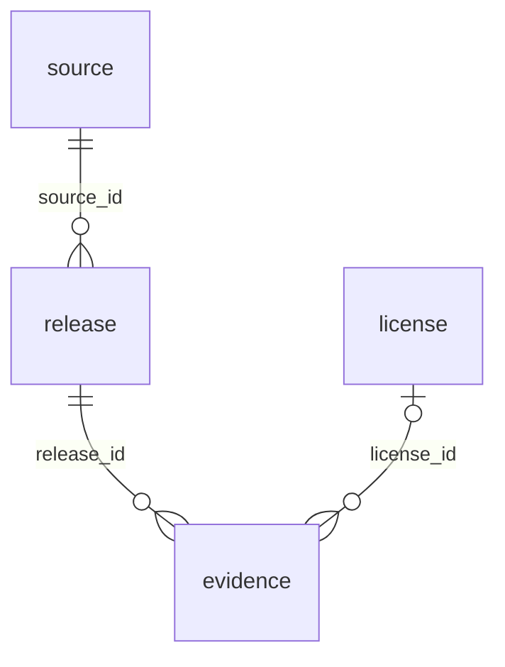
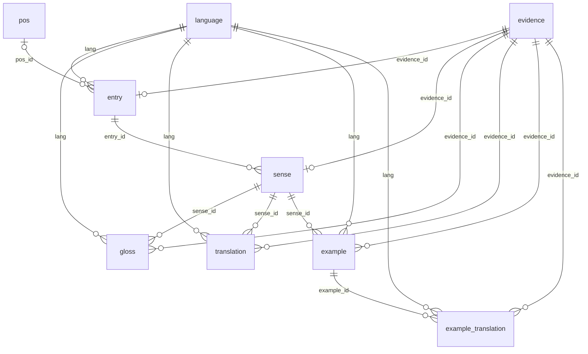
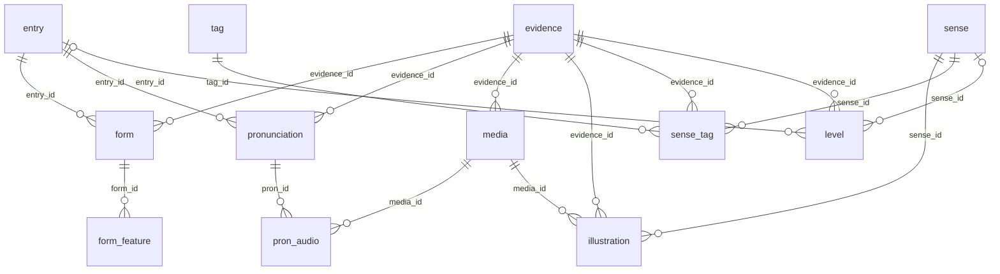
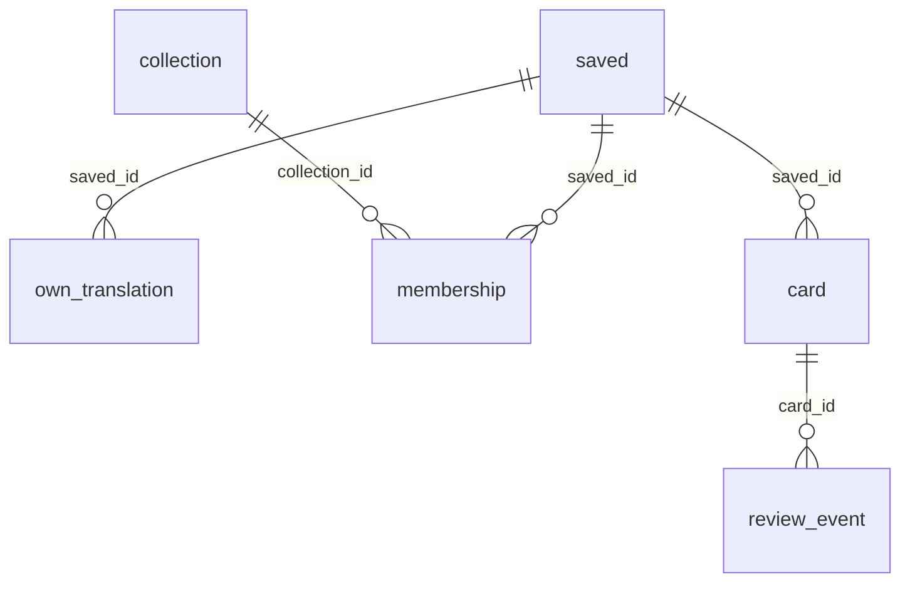
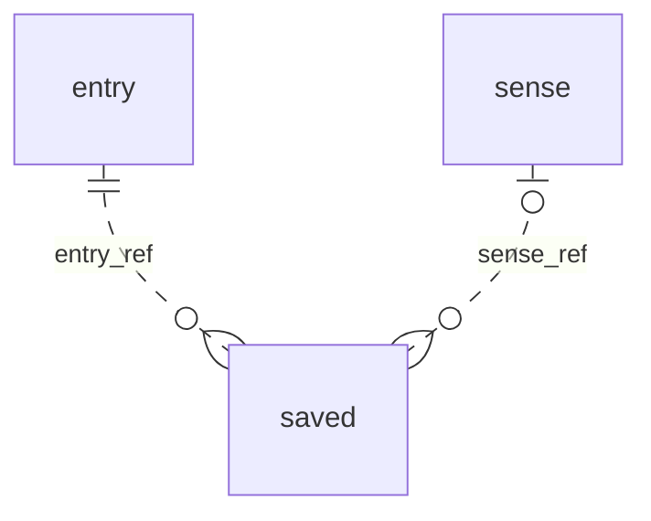

# LexiFlow · Связи проектируемой базы

**Черновик для согласования.** Диаграммы образуют одну модель: повторяющееся имя обозначает ту же таблицу. У линии подписан столбец внешнего ключа в дочерней таблице. Вертикальная черта означает один объект, круг — необязательность, «лапка» — множество. Полные столбцы, составные ключи, частичные ограничения и индексы приведены в [физической модели](DATABASE_DESIGN_DRAFT.md).

## Источники и права

## Статьи, значения и примеры

## Формы, произношение и аннотации

## Личное хранилище

Для `level` действует XOR: каждая оценка адресована ровно одной статье или одному значению. Для `pron_audio` допустим файл типа audio, для `illustration` — image. Дневная статистика вычисляется группировкой `review_event`; отдельной таблицы итогов нет.

## Граница файлов

Пунктирные связи ниже разрешаются приложением по постоянным ID. Кардинальности относятся к моменту сохранения. После замены корпуса ссылка может перестать разрешаться; исходный ID и подпись остаются в личном файле.

