# Практическая глава · технические свидетельства LexiFlow

Тема работы — «Создание мобильного приложения „Словарь иностранных слов“». LexiFlow реализует автономный поиск по английскому и русскому ключам, отображение словарной статьи и изучение сохранённых значений.

## Данные и приложение

```mermaid
flowchart LR
    TEI["FreeDict TEI и SHA-256"] --> Import["Потоковое чтение источника"]
    Import --> Stage["Локальный staging и исходные локаторы"]
    Stage --> Select["Отбор EN–RU и независимый RU–EN"]
    Select --> Package["SQLite V2 или V3 и компактный манифест"]
    Package --> Repo["Проверка хешей и атомарная активация"]
    Repo --> ViewModel["ViewModel и Android XML"]
    ViewModel --> Personal["Room · сохранения, карточки и история"]
```

SQLite хранит статьи с POS и отдельные значения с переводами. Индексы обеспечивают поиск по исходному написанию и обратный поиск по русскому эквиваленту. NFC, полное свёртывание регистра и нормализация пробелов дают стабильные поисковые ключи. Исходный текст остаётся в отдельном поле. Дочерние определения, чья связь с переводом не установлена, доступны на уровне статьи. Для данных обучения используется отдельная Room-база. Идентификаторы исследования выводятся из SHA снимка и локатора исходной записи. [Архитектура](ARCHITECTURE.md) · [Контракт и индексы](DICTIONARY_PACKAGE_CONTRACT.md)

Базовый FreeDict EN–RU 2025.11.23 содержит 20 000 нормализованных английских написаний, 23 516 статей, 37 871 значение и 81 970 строк перевода. Покрытие составляет 194/264 по отдельному набору точных запросов. Подсчёт отражает наличие ключа. Для восьми размеченных запросов проверено наличие ожидаемого значения в первых десяти строках, результат — 6/8. Двуязычная пара сохраняет этот корпус и добавляет 5 000 русских написаний. Отдельная выборка для проверки дополнительного покрытия дала 18/128 точных ответов прямого пакета. Сравнение вариантов 10 000, 20 000 и 40 847 доступно в агрегатах для pandas. [Сравнение данных и ограничения](OVERNIGHT_CHECKPOINT.md)

Компактный формат 3 восстанавливает точную строку атрибуции из общей таблицы. Исследовательское расширение CEFR-J хранит 6 915 ссылок для 6 914 английских статей по паре лемма и POS. Двуязычный пакет 20 000 EN + 20 000 RU содержит 43 694 статьи, 60 781 значение и 116 665 переводов. По 128 русским запросам, отсутствовавшим в базовой выдаче EN–RU, новый корпус дал 79 точных совпадений. Контрольный вариант на 5 000 давал 18.

Из закреплённых ответов Tatoeba добавлены 23 пары в 13 английских статей. В каждой паре сохранена атрибуция исходного предложения и перевода. Из разделов dev и test UD EWT r2.16 получено 15 грамматических анализов для 13 запрошенных написаний. Исходные предложения UD EWT исключены из импорта. В курсовой эти результаты можно показать в отдельных блоках словарной статьи. [Контракт пакета](DICTIONARY_PACKAGE_CONTRACT.md) · [Методика и показатели](OVERNIGHT_CHECKPOINT.md)

## Проверяемость результатов

На Samsung SM-X516B, Android 14, в отдельной установке измерены запуск, обновление словаря, обычный поиск, использование карточек и сохранение обучающих данных. При переходе с 5 000 до 20 000 дополнительно сверены идентификаторы, переводные значения и локаторы. Показывая работу приложения, можно выделить результаты для нескольких частей речи, статью с исходной транскрипцией, сохранённую запись и повторение. Ссылки на локальные кадры и агрегаты для pandas есть в контрольной точке. Устройство на Android 10, авиарежим, запуск на устройстве с 3 ГБ ОЗУ и редакторская приёмка остаются отдельными задачами. [Проверки](TEST_PLAN.md) · [Приёмка](STAGE1_ACCEPTANCE.md)

## Варианты редакторской приёмки

Первый вариант к обсуждению — небольшой production-пакет в пределах 5 000 написаний с индивидуальной проверкой допущенных значений. Этот подход облегчает разрешение спорных случаев и даёт ограниченное покрытие. Второй вариант — использовать корпус 20 000 как верхнюю границу первого выпуска после утверждения политики конкретного источника и стратифицированной проверки, с полным ручным разбором конфликтов и исключений. Сравнивать стоит покрытие запросов, стоимость редактуры и время первой активации.

Предлагаемый порядок эксперимента — структурная проверка всей базы, затем независимая двойная проверка 280 случайно выбранных значений, по 40 из семи страт. Для каждого значения раздельно отмечаются смысл, POS и полезность обратной выдачи. Отдельные выборки из 60 пар сопоставления, 60 примеров и 60 записей полей оценивают соответствие смысла, пригодность предложения и точность метаданных. Цепочку атрибуции проверяет валидатор для каждой записи. До выпуска предлагается требовать 100% структурной полноты и разобрать все обнаруженные ошибки смысла, происхождения и прав среди проверенных записей. Сводный проходной порог и решение по размеру устанавливает владелец.

Размер каждой страты допускает описание проблем по группам. Для оценки всего корпуса нужны известные размеры групп, веса выборок, независимые человеческие решения и учёт пересечений. Редкие, специальные и маркированные значения сохраняются с исходными признаками. Неоднозначные привязки, переработанные переводы и внешние цитаты получают отдельное редакторское и правовое решение. Распространение словарных данных требует соблюдения применимых условий атрибуции и ShareAlike. [Свидетельства о лицензиях](STAGE1_SOURCE_EVIDENCE.md) · [Политика экспорта](DICTIONARY_RELEASE_PIPELINE.md)

Для будущего перехода от локальных UUID к утверждённым производственным ID нужно хранить явную карту, проверяемую по снимку, локатору и записи решения. При смене снимка сохраняются ссылки на исходные значения, к которым есть подтверждённое соответствие. Для удалённых статей запись показывает сохранённый пользователем текст. Карточки, заметки и история сохраняются независимо от допуска новой словарной статьи.

[Варианты выпуска и комплект приёмки](STAGE1_RELEASE_DECISION.md)

## Масштабирование учебных метаданных

Дополнительный исследовательский пакет сохраняет 20 000 английских и 20 000 русских написаний. Импортёр морфологии проверяет взаимную совместимость леммы, POS и явно размеченной грамматической характеристики. 1 696 анализов хранятся в SQLite с локаторами UD. Для 30 пар Tatoeba сохранено происхождение обоих предложений, а блок употребления находится на уровне статьи.

Проверка пакетов сверяет стабильные UUID и поля атрибуции до и после обновления. Независимые наборы поисковых запросов и грамматические пробы сохранены как локальные CSV. Содержательные выводы редакторской проверки остаются предварительными. [Методика, измерения и границы эксперимента](OVERNIGHT_CHECKPOINT.md)
